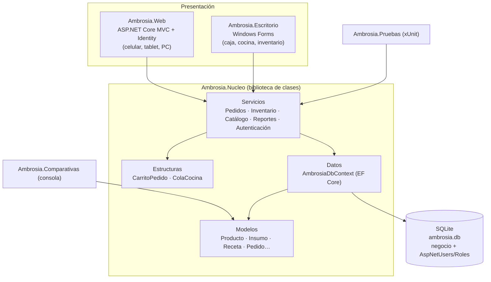
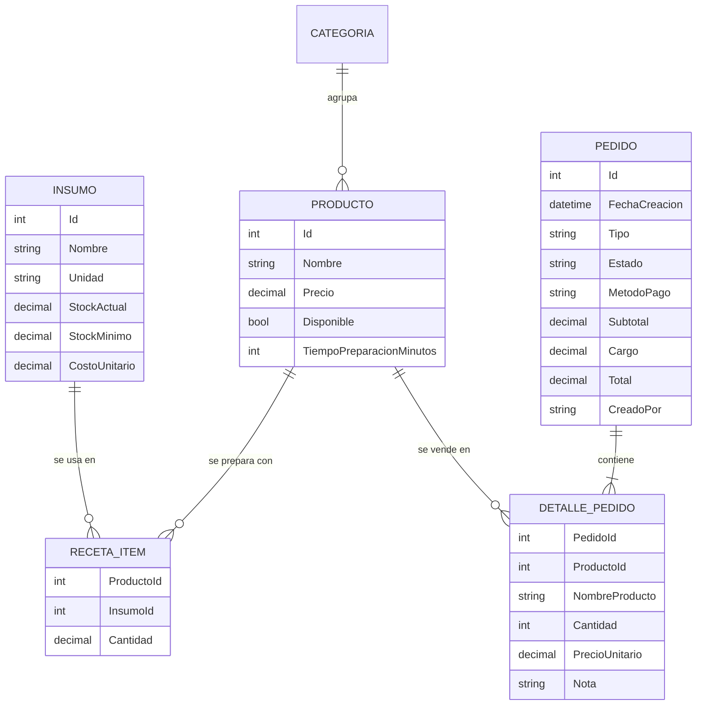
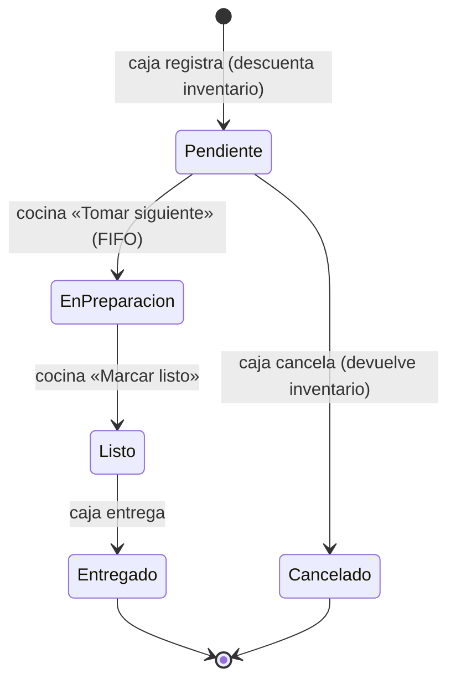
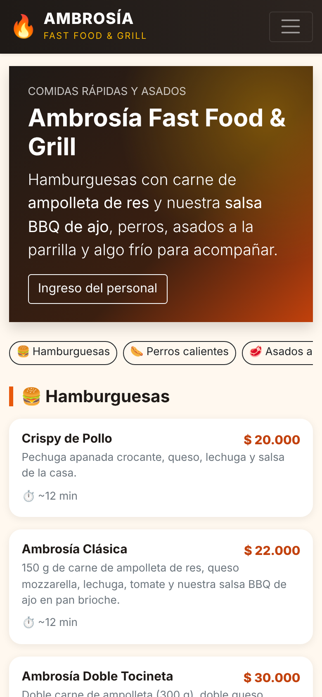
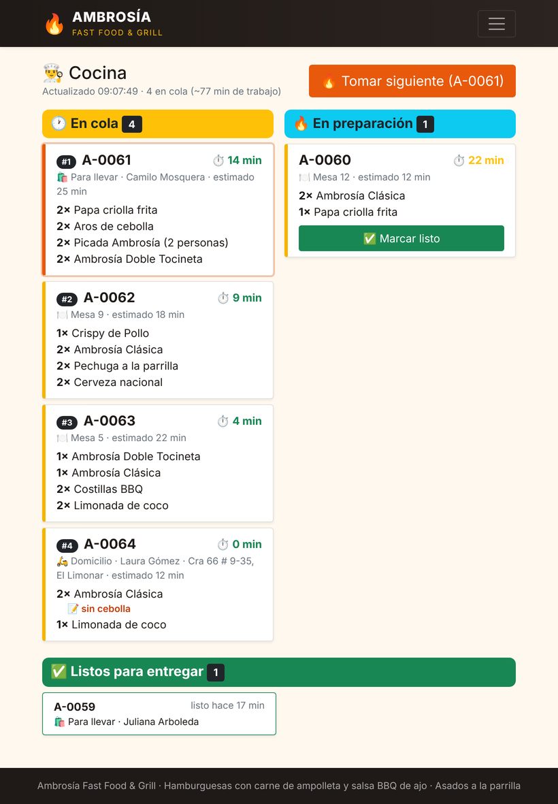
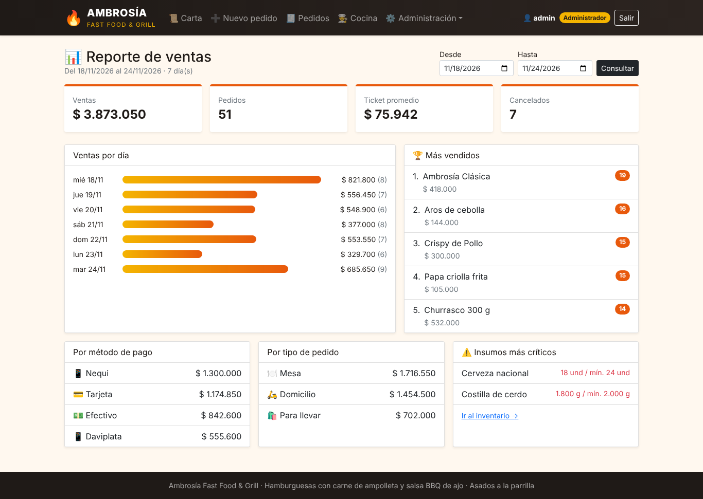
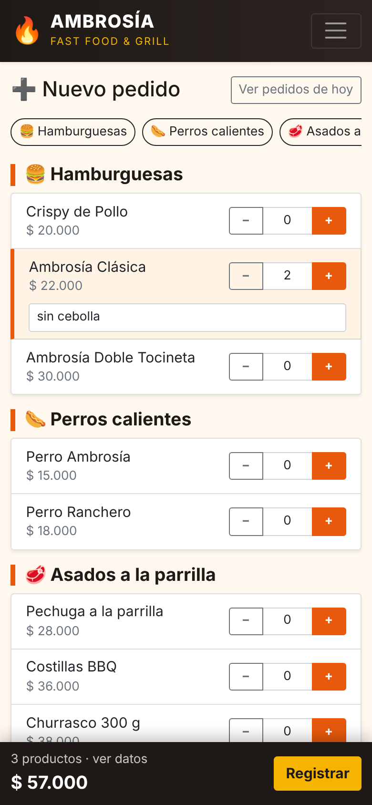
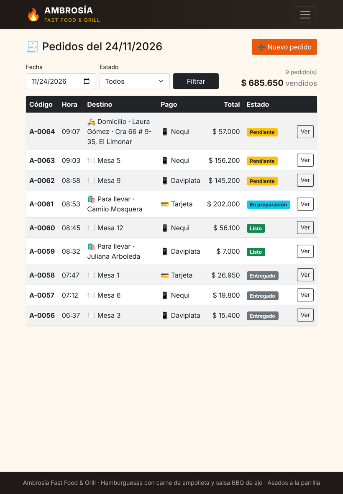
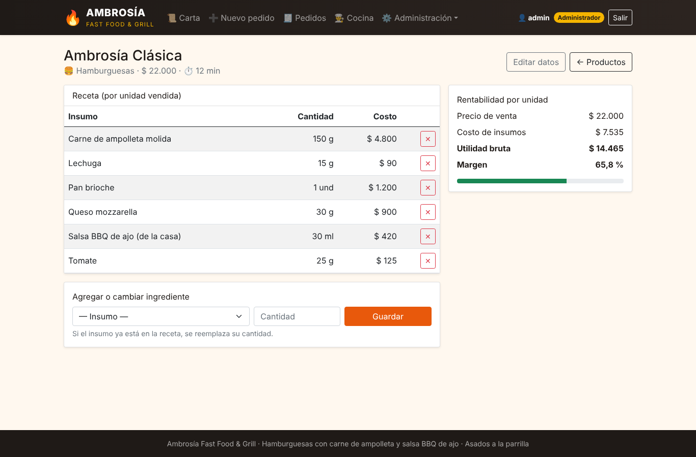

# 🔥 Ambrosía Fast Food & Grill — Sistema de pedidos e inventario

Miniproyecto 2 · **Lenguajes de Programación** · Universidad Santiago de Cali
Creado por **Yimis Buenaventura Castro** y **Fernando José Angulo Nuñez**

Solución .NET 8 para un restaurante de comidas rápidas y asados: la **caja** registra pedidos (mesa, para llevar o domicilio), la **cocina** los atiende en orden de llegada y el **administrador** gestiona la carta, las recetas, el inventario, los usuarios y los reportes de ventas. Hay una **aplicación web (ASP.NET Core MVC)** y una **aplicación de escritorio (Windows Forms)** que comparten la misma **biblioteca de clases** y la misma **base de datos (EF Core + SQLite)**.

---

## 1. Problemática

Ambrosía vende hamburguesas con carne de ampolleta de res y salsa BBQ de ajo, perros calientes, asados a la parrilla, acompañantes y bebidas. Sin un sistema:

- Los pedidos se anotan en papel y se pierden o se cocinan en desorden en horas pico.
- Nadie sabe cuánta carne, pan o tocineta queda hasta que se acaba en pleno servicio.
- No se conoce el costo real de cada plato ni el margen de ganancia.
- No hay cifras de ventas por día, por medio de pago (efectivo, Nequi, Daviplata, tarjeta) ni de los productos más vendidos.

## 2. Justificación

| Necesidad | Solución en el sistema |
|---|---|
| Orden en cocina | Cola FIFO (`Queue<Pedido>`): siempre se prepara primero el pedido más antiguo. |
| Control de inventario | Cada producto tiene **receta**; al vender se descuentan los insumos y se avisa cuando uno cruza su mínimo (evento `StockBajo`). |
| Rentabilidad | Costo de receta y margen por producto calculados con los costos de los insumos. |
| Decisiones con datos | Reporte de ventas por día, por método de pago, por tipo de pedido y ranking de productos. |
| Seguridad | Inicio de sesión con **ASP.NET Core Identity** y 3 roles con permisos distintos. |
| Trabajo en piso | Web **responsive** (celular del mesero, tablet de cocina, PC del administrador) y app de escritorio para la caja. |

## 3. Cumplimiento de los requerimientos

| Requerimiento del enunciado | Dónde está |
|---|---|
| Biblioteca de clases con dominio y negocio | `src/Ambrosia.Nucleo` (modelos, servicios, estructuras, excepciones) |
| Patrón MVC en la web | `src/Ambrosia.Web` (Controllers / Models / Views) |
| Aplicación de escritorio | `src/Ambrosia.Escritorio` (Windows Forms) |
| Base de datos con Entity Framework Core | `AmbrosiaDbContext` (SQLite), relaciones con API fluida, datos iniciales |
| Estructuras de datos justificadas y comparadas | Proyecto `Ambrosia.Comparativas` e informe del miniproyecto |
| ASP.NET Core Identity + al menos 2 roles | `CuentaController`, `UsuariosController`, roles **Administrador**, **Cajero** y **Cocina** |
| Diseño responsive (tablet y smartphone) | Bootstrap 5 + CSS propio; capturas en [`docs/capturas`](docs/capturas) |
| Características del lenguaje C# | `Ambrosia.Nucleo` (POO, records, genéricos, eventos, LINQ…) e informe del miniproyecto |
| Repositorio en GitHub | Ver sección 9 |

## 4. Arquitectura



- **Web y escritorio no repiten lógica**: ambos llaman los mismos servicios de la biblioteca.
- **Misma base de datos y mismos usuarios**: un pedido registrado en la caja de escritorio aparece en la tablet de cocina (web), y un usuario creado en la web inicia sesión en el escritorio.

### Modelo de datos



Ciclo de vida de un pedido (las transiciones las valida `ServicioPedidos.EsTransicionValida`):



## 5. Estructura de la solución

```
Ambrosia.sln
├── src/
│   ├── Ambrosia.Nucleo/          Biblioteca de clases (net8.0)
│   │   ├── Modelos/              Entidades, enums, records y struct
│   │   ├── Datos/                DbContext, configuración SQLite, datos iniciales
│   │   ├── Servicios/            Reglas de negocio (pedidos, inventario, catálogo, reportes, login)
│   │   ├── Estructuras/          CarritoPedido (Dictionary + Stack), ColaCocina (Queue)
│   │   ├── Excepciones/          Jerarquía de excepciones propias
│   │   ├── Seguridad/            Constantes de roles
│   │   └── Utilidades/           Métodos de extensión (formato de pesos, enums)
│   ├── Ambrosia.Web/             ASP.NET Core MVC + Identity (net8.0)
│   ├── Ambrosia.Escritorio/      Windows Forms (net8.0-windows)
│   └── Ambrosia.Comparativas/    Mediciones de estructuras de datos (consola)
├── tests/
│   └── Ambrosia.Pruebas/         xUnit: 36 pruebas de estructuras, reglas y servicios
└── docs/
    └── capturas/                 Capturas en celular, tablet y PC
```

## 6. Cómo ejecutar

**Requisitos:** [SDK de .NET 8](https://dotnet.microsoft.com/download) (también sirve .NET 9 o 10) y, para la app de escritorio, Windows. Recomendado: Visual Studio 2022 o posterior con las cargas de trabajo *ASP.NET y desarrollo web* y *Desarrollo de escritorio de .NET*.

### Con Visual Studio
1. Abrir `Ambrosia.sln`.
2. Clic derecho en la solución → **Configurar proyectos de inicio** → **Varios proyectos de inicio** → marcar `Ambrosia.Web` y `Ambrosia.Escritorio` como **Iniciar**.
3. F5. Se abre el navegador con la carta y la ventana de inicio de sesión del escritorio.

### Con la terminal
```bash
dotnet restore
dotnet run --project src/Ambrosia.Web            # web en http://localhost:5271
dotnet run --project src/Ambrosia.Escritorio     # escritorio (solo Windows)
dotnet test                                      # pruebas
dotnet run -c Release --project src/Ambrosia.Comparativas   # comparativas de estructuras
```

La **primera vez** que arranca cualquiera de las dos aplicaciones se crea la base de datos con la carta, 27 insumos, recetas, una semana de ventas de ejemplo y pedidos de hoy en distintos estados.

### Usuarios de prueba

| Usuario | Contraseña | Rol | Al entrar va a… |
|---|---|---|---|
| `admin` | `Admin123*` | Administrador | Reportes |
| `cajero` | `Cajero123*` | Cajero | Nuevo pedido |
| `cocina` | `Cocina123*` | Cocina | Pantalla de cocina |

### Permisos por rol

| Pantalla | Público | Cajero | Cocina | Administrador |
|---|:-:|:-:|:-:|:-:|
| Carta | ✔ | ✔ | ✔ | ✔ |
| Nuevo pedido / Pedidos (entregar, cancelar) | | ✔ | | ✔ |
| Cocina (tomar siguiente, marcar listo) | | | ✔ | ✔ |
| Productos y recetas, Categorías, Inventario | | | | ✔ |
| Reportes, Usuarios y roles | | | | ✔ |

En la web se controla con `[Authorize(Roles = ...)]`; en el escritorio se muestran solo las pestañas del rol.

### Base de datos

- Archivo SQLite compartido: `%LOCALAPPDATA%\AmbrosiaFastFood\ambrosia.db` (en Windows).
- Para **empezar de cero**, cerrar las aplicaciones y borrar ese archivo.
- Para usar otra ubicación, escribir la cadena en `src/Ambrosia.Web/appsettings.json` → `ConnectionStrings:Ambrosia`.
- **Migraciones (opcional):** el proyecto crea el esquema con `EnsureCreated`. Si el profesor pide migraciones:
  ```bash
  dotnet tool install --global dotnet-ef --version 8.*
  dotnet ef migrations add Inicial --project src/Ambrosia.Nucleo --startup-project src/Ambrosia.Web
  ```
  Luego borrar `ambrosia.db`: al arrancar, `InicializadorBaseDatos` detecta las migraciones y usa `Migrate()`.

### Probar el diseño responsive

- En el navegador: `F12` → ícono de dispositivo (Ctrl+Shift+M) → elegir *iPhone* o *iPad*.
- En un celular real en la misma red Wi-Fi: ejecutar la web con el perfil **«red-local (celular o tablet)»** y abrir `http://IP-DEL-PC:5271`. Si Windows pregunta, permitir el acceso en el Firewall.

## 7. Funcionalidades

**Caja (web y escritorio)**
- Pedido para mesa, para llevar o domicilio, con nota por producto ("sin cebolla") y observaciones.
- Cargo automático según el tipo: servicio voluntario del 10 % en mesa, domicilio de $ 4.000 (gratis desde $ 80.000), sin cargo para llevar.
- Valida inventario **antes** de registrar: si no alcanza, explica qué insumo falta y no descuenta nada.
- Escritorio: agregar con doble clic, **Deshacer (Ctrl+Z)** ilimitado, total en vivo.

**Cocina (tablet)**
- Tres columnas: en cola (FIFO, numerada), en preparación y listos.
- Tiempo de espera en verde, amarillo o rojo frente al tiempo estimado de preparación.
- Se actualiza sola (web cada 30 s, escritorio cada 15 s).

**Administración**
- Productos con receta, costo de insumos y **margen** de ganancia.
- Inventario con alertas ordenadas por urgencia, valor en bodega y registro de compras.
- Reporte por rango de fechas: ventas por día, ticket promedio, métodos de pago, tipo de pedido y top 5.
- Usuarios: crear cuentas del personal con su rol, eliminar cuentas.

## 8. Capturas

| Celular | Tablet | PC |
|---|---|---|
|  |  |  |
|  |  |  |

Todas las capturas están en [`docs/capturas`](docs/capturas).

## 9. Repositorio en GitHub

```bash
git init
git add .
git commit -m "Ambrosía Fast Food & Grill: web MVC, escritorio WinForms y biblioteca compartida"
git branch -M main
git remote add origin https://github.com/yimis-source/AmbrosiaFastFoodGrill.git
git push -u origin main
```

(El repositorio se crea antes en github.com → **New repository**, sin README para evitar conflictos. El `.gitignore` ya excluye `bin/`, `obj/` y la base de datos.)

## 10. Metodología

1. **Análisis del negocio**: flujo real de un pedido en Ambrosía (caja → cocina → entrega) y de los insumos (compra → receta → venta).
2. **Diseño por capas**: primero la biblioteca (modelos, reglas, estructuras) y sus pruebas; después las dos interfaces, que solo llaman a los servicios.
3. **Decisión de estructuras basada en mediciones** (`Ambrosia.Comparativas`), documentada en el informe del miniproyecto.
4. **Pruebas automáticas** (xUnit) de cada regla: descuento de inventario, cancelación, FIFO, cargos, transiciones, alertas, login.
5. **Iteraciones** cortas por módulo (carta → pedidos → cocina → inventario → reportes → usuarios) y revisión en celular, tablet y PC.

## 11. Autores

Proyecto creado por:

- **Yimis Buenaventura Castro**
- **Fernando José Angulo Nuñez**

Miniproyecto 2 de Lenguajes de Programación, Universidad Santiago de Cali. Docente: Rudy Alexis Guejia Burbano, Ph.D.
